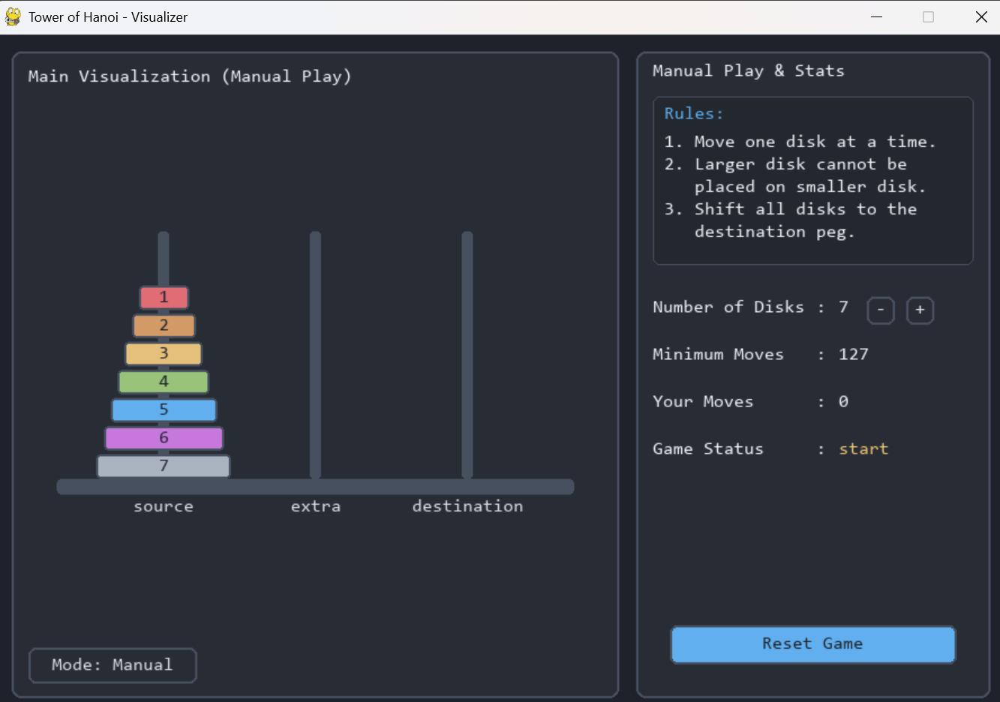
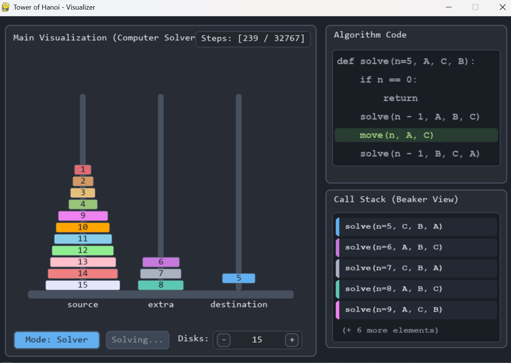
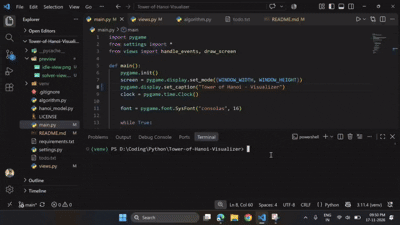

# 🗼 Tower of Hanoi Visualizer

[](LICENSE)
[](https://www.python.org/)
[](https://www.pygame.org/)

**Tower of Hanoi Visualizer** is an interactive, real-time algorithm and recursion visualizer built from scratch in Python using the **Pygame** framework. Designed to bridge the gap between abstract recursive theory and visual execution, it combines smooth 3-phase kinematic disk animations, live line-by-line code highlighting, and a dynamic **"Beaker View" Call Stack** inside a single-threaded, frame-accurate simulation loop.

---

## 📸 Demo & Screenshots

### Interface & Live Recursion Preview
| Initial Setup & Idle State | Live Solver, Code & Beaker Stack |
| :---: | :---: |
|  |  |

> 🎬 **Watch the Showcase Video:**



---

## 📦 Table of Contents

- [Features](#-features)
- [Technical Architecture & File Structure](#-technical-architecture--file-structure)
- [How It Works (Algorithmic Logic)](#-how-it-works-algorithmic-logic)
- [Installation & Getting Started](#-installation--getting-started)
- [Usage Guide](#-usage-guide)
- [Contributing](#-contributing)
- [License](#-license)

---

## ✨ Features

### 1. 3-Phase Kinematic Disk Animation
* Every disk transition follows a smooth, calculated 3-phase kinematic trajectory (**Lift $\rightarrow$ Slide $\rightarrow$ Drop**) rather than instant teleportation.
* Synchronized animation speeds ensure that visual motion matches recursive state transitions cleanly across varying disk counts.

### 2. Live Algorithm Code Panel
* Displays the recursive Tower of Hanoi algorithm cleanly formatted in `Courier New` (17pt Bold).
* **Real-Time Line Highlighting:** Highlights the exact active line of code being executed (`#98c379` accent) in sync with runtime variable updates (`n`, `source`, `target`, `aux`).

### 3. The "Beaker View" Call Stack
* **True LIFO Stack Simulation:** Visualizes active recursive function frames inside a vertical beaker container using bottom-up ("lower gravity") rendering—keeping the root call anchored at the base while deeper recursive frames stack upward.
* **Disk-Matched Color Coding:** Each stack frame is color-coded to match the exact disk index `n` it represents, displaying live mapped tower parameters (e.g., `solve(n=2, A, C, B)`).
* **Smart Overflow Handling:** Automatically bounds visible stack frames to prevent UI clutter and displays a clean `(+ X more elements)` summary indicator at the base when recursion depth exceeds the container height.

### 4. Interactive Controls & Step Tracking
* Dynamically adjust the number of disks ($n$) before execution.
* Real-time step counter displaying current progress against the theoretical minimum moves ($2^n - 1$) formatted as `[Step / Min Steps]`, complete with instant **Reset** support.

---

## 🛠️ Technical Architecture & File Structure

The project follows a clean, modular architecture separating core state models, recursive generator logic, configuration constants, and Pygame rendering views:

```text
📂 Tower-of-Hanoi-Visualizer/
│
├── 📂 preview/           # Screenshots and demo video used in this README
│
├── 📄 main.py            # Entry point: Pygame initialization and main event/render loop
├── 📄 algorithm.py       # Recursive Tower of Hanoi generator yielding execution & stack states
├── 📄 hanoi_model.py     # Core data structures and peg/disk state management
├── 📄 views.py           # UI rendering engine (Pegs, Kinematics, Code Panel, Beaker Stack)
├── 📄 settings.py        # Global color palettes, fonts, dimensions, and animation speed constants
├── 📄 requirements.txt   # Python package dependencies
├── 📄 .gitignore         # Git exclusion rules
└── 📄 LICENSE            # MIT License
```

| Module | Responsibility |
| :--- | :--- |
| `main.py` | Bootstraps the Pygame window, manages the main frame loop, and coordinates events and updates. |
| `algorithm.py` | Implements `hanoi_moves_generator`, yielding step-by-step execution states, line numbers, and call stack frames. |
| `hanoi_model.py` | Encapsulates the Tower of Hanoi state model, peg arrays, and move validation logic. |
| `views.py` | Handles all visual rendering, 3-phase disk interpolation, active code highlighting, and the Beaker View stack. |
| `settings.py` | Centralizes UI theme colors, disk color mappings (`DISK_COLORS`), layout coordinates, and speed settings. |

---

## 🧠 How It Works (Algorithmic Logic)

Instead of running recursion in a blocking loop or background thread, `algorithm.py` uses a **Python generator** (`yield` and `yield from`) to pause and resume recursion one atomic step per animation cycle:

1. **State Yielding:** At each function entry, base-case check, recursive branch, and disk movement, the generator yields a tuple containing `(n, source, target, line, depth, disk, stack_list)`.
2. **Call Stack Tracking:** Active frames are pushed onto a tracked call stack list upon entering a recursive call and popped upon returning, giving `views.py` an exact snapshot of memory at every frame.
3. **Complexity:** Solves any configuration of $n$ disks in the optimal $\mathcal{O}(2^n)$ moves ($2^n - 1$ total steps) while using $\mathcal{O}(n)$ call stack space.

---

## 📦 Installation & Getting Started

### Prerequisites
* **Python 3.11.4** or higher
* **Pygame 2.6.1** or higher

### Step 1: Clone the Repository
```bash
git clone https://github.com/TechnicalCoderji/Tower-of-Hanoi-Visualizer.git
cd Tower-of-Hanoi-Visualizer
```

### Step 2 (Optional): Create a Virtual Environment
```bash
python -m venv venv

# Windows
venv\Scripts\activate

# macOS / Linux
source venv/bin/activate
```

### Step 3: Install Dependencies
```bash
pip install -r requirements.txt
```

### Step 4: Run the Application
```bash
python main.py
```

---

## 🕹️ Usage Guide

1. **Select Disk Count:** Use the `-` and `+` buttons in the control bar to set the number of disks ($n$) while in the `idle` state.
2. **Start Visualization:** Click **Solve** to launch the recursive generator.
3. **Observe Execution:**
   * Watch disks smoothly lift, glide across pegs, and drop into place on the left canvas.
   * Follow the green highlighted line in the **Algorithm Code** panel (top-right) to see which branch is currently executing.
   * Monitor active function frames pushing and popping inside the **Call Stack (Beaker View)** panel (bottom-right).
4. **Reset:** Once completed (or anytime you wish to restart), click **Reset** to restore the disks to Peg `A` and reset the step counter to `0`.

---

## 🤝 Contributing

Contributions, bug reports, and feature suggestions are always welcome!

1. **Report Issues:** Open a detailed issue on the [GitHub Issues](https://github.com/TechnicalCoderji/Tower-of-Hanoi-Visualizer/issues) page.
2. **Submit a Pull Request:** Fork the repository, create a feature branch, commit your changes, and open a Pull Request.

---

## 📜 License

This project is open-source and licensed under the terms of the [MIT License](LICENSE).

Developed with ❤️ by **Technical Coderji** © 2026.